# Guía de uso de Resilencia-Kubernetes

*[Read in English: USAGE_GUIDE.md](USAGE_GUIDE.md)*

Esta guía explica cómo instalar, iniciar, verificar y utilizar el proyecto desde
el panel web, la terminal y las interfaces Swagger. Está dirigida a usuarios que
quieren reproducir el laboratorio localmente, colocar órdenes, observar los
microservicios y ejecutar pruebas de resiliencia de forma controlada.

Las imágenes de esta guía son **capturas reales del proyecto en ejecución** con
Docker Compose. Se obtuvieron de la versión auditada en la rama `main`, commit
`0bbca19`. Los nombres y valores generados con Faker pueden cambiar en otra
instalación, pero los controles y procedimientos son los mismos.

> [!WARNING]
> Este proyecto es un laboratorio académico local. No debe exponerse a Internet
> ni utilizarse como sistema de producción. Los endpoints administrativos no
> tienen autenticación y el panel puede controlar contenedores y, cuando se
> configura, recursos de Kubernetes.

## Contenido

1. [Qué hace el proyecto](#1-qué-hace-el-proyecto)
2. [Arquitectura y flujo de una orden](#2-arquitectura-y-flujo-de-una-orden)
3. [Requisitos](#3-requisitos)
4. [Preparación inicial](#4-preparación-inicial)
5. [Iniciar el proyecto con Docker Compose](#5-iniciar-el-proyecto-con-docker-compose)
6. [Preparar usuarios y productos](#6-preparar-usuarios-y-productos)
7. [Recorrido por el panel de control](#7-recorrido-por-el-panel-de-control)
8. [Colocar y consultar órdenes](#8-colocar-y-consultar-órdenes)
9. [Clientes, inventario, pagos y notificaciones](#9-clientes-inventario-pagos-y-notificaciones)
10. [Pruebas de tráfico y chaos engineering](#10-pruebas-de-tráfico-y-chaos-engineering)
11. [Observabilidad con Prometheus, Grafana y Jaeger](#11-observabilidad-con-prometheus-grafana-y-jaeger)
12. [Uso de Swagger y de la API](#12-uso-de-swagger-y-de-la-api)
13. [Uso del CLI](#13-uso-del-cli)
14. [Ejecución opcional en Kubernetes](#14-ejecución-opcional-en-kubernetes)
15. [Detener, reiniciar y borrar datos](#15-detener-reiniciar-y-borrar-datos)
16. [Escenarios reproducibles](#16-escenarios-reproducibles)
17. [Solución de problemas](#17-solución-de-problemas)
18. [Limitaciones conocidas](#18-limitaciones-conocidas)
19. [Mapa de archivos y documentación](#19-mapa-de-archivos-y-documentación)

## 1. Qué hace el proyecto

**Resilencia-Kubernetes** simula un sistema de comercio electrónico distribuido.
Una orden atraviesa cinco microservicios:

1. `order-service` recibe y coordina la solicitud.
2. `user-service` comprueba que el cliente exista y esté activo.
3. `inventory-service` comprueba y reserva el inventario.
4. `payment-service` procesa y registra el pago simulado.
5. `notification-service` registra una notificación simulada.

El laboratorio permite observar o provocar:

- reintentos ante fallos temporales;
- apertura, recuperación y cierre del circuit breaker de pagos;
- latencia, errores y timeouts artificiales;
- compensación de inventario cuando una orden no termina;
- métricas Prometheus y paneles Grafana;
- trazas distribuidas en Jaeger;
- recuperación de pods, elección de líder y HPA en Kubernetes.

Tecnologías principales:

- Python 3.12, FastAPI y SQLAlchemy asíncrono;
- PostgreSQL 16;
- Docker Compose;
- Prometheus, Grafana, OpenTelemetry Collector y Jaeger;
- Kubernetes/minikube y un chart Helm experimental;
- panel web estático servido por FastAPI;
- CLI en Python, k6 y JMeter.

## 2. Arquitectura y flujo de una orden

```text
Usuario o panel
      |
      v
order-service :8100
      |
      +--> user-service :8101 -------- valida al cliente
      |
      +--> inventory-service :8102 --- consulta y reserva stock
      |
      +--> payment-service :8103 ----- registra el pago
      |
      +--> notification-service :8104  registra la notificación
      |
      +--> PostgreSQL :5434 ---------- persiste el estado y checkpoints
```

El flujo normal termina con una orden `paid` y estado interno `completed`. Si un
paso falla, `order-service` conserva checkpoints del avance e intenta compensar
las operaciones que corresponda, por ejemplo liberar inventario reservado.

En Docker Compose, `order-service` es siempre el orquestador. En Kubernetes, los
cinco servicios incorporan la lógica compartida de elección de líder y pueden
asumir la orquestación según su prioridad configurada.

## 3. Requisitos

### Requisitos para Docker Compose

- Docker Desktop iniciado y con el motor Linux disponible.
- Git, si se va a clonar el repositorio.
- PowerShell en Windows o bash en macOS/Linux.
- Al menos los puertos indicados en la tabla de la sección 5 disponibles.

No es necesario instalar PostgreSQL, Prometheus, Grafana, Jaeger, Python o Node
en el host para el recorrido principal: Docker ejecuta esos componentes.

### Requisitos opcionales para Kubernetes

- `kubectl`;
- minikube;
- `helm`, únicamente para experimentar con `charts/resilencia/`.

Instalación de minikube en Windows:

```powershell
winget install -e --id Kubernetes.minikube
```

## 4. Preparación inicial

Abre una terminal y entra a la raíz del proyecto:

```powershell
cd C:\ruta\al\proyecto\Resilencia-Kubernetes
```

Comprueba que estás en la carpeta correcta:

```powershell
Get-ChildItem README.md, compose.yml, run.ps1, GUIA_DE_USO.md
```

### 4.1 Crear el archivo de configuración

En Windows PowerShell:

```powershell
Copy-Item .env.example .env
```

En macOS/Linux:

```bash
cp .env.example .env
```

El archivo `.env` es opcional porque `compose.yml` contiene valores por defecto.
Sin embargo, copiarlo facilita cambiar puertos, cantidades de datos y parámetros
de resiliencia.

### 4.2 Variables importantes

| Variable | Valor de referencia | Función |
| --- | --- | --- |
| `POSTGRES_PORT` | `5434` | Puerto de PostgreSQL publicado en el host |
| `ORDER_SERVICE_PORT` | `8100` | API del orquestador |
| `USER_SERVICE_PORT` | `8101` | API de clientes |
| `INVENTORY_SERVICE_PORT` | `8102` | API de inventario |
| `PAYMENT_SERVICE_PORT` | `8103` | API de pagos |
| `NOTIFICATION_SERVICE_PORT` | `8104` | API de notificaciones |
| `PROMETHEUS_PORT` | `9091` | Interfaz de Prometheus |
| `GRAFANA_PORT` | `3001` | Interfaz de Grafana |
| `JAEGER_PORT` | `16687` | Interfaz de Jaeger |
| `SEED_USERS_COUNT` | `50000` | Número objetivo de clientes Faker |
| `SEED_PRODUCTS_COUNT` | `0` | Productos Faker creados por el seeder |
| `FAILURE_RATE` | `0.0` | Probabilidad inicial de fallo por solicitud |
| `LATENCY_MS` | `0` | Latencia artificial inicial |
| `TIMEOUT_RATE` | `0.0` | Probabilidad inicial de timeout |
| `RETRY_ENABLED` | `false` | Habilita reintentos al iniciar |
| `RETRY_COUNT` | `3` | Número de reintentos |
| `RETRY_DELAY_MS` | `100` | Espera entre intentos |
| `HTTP_TIMEOUT` | `5.0` | Timeout entre microservicios, en segundos |

> [!IMPORTANT]
> El valor predeterminado `SEED_PRODUCTS_COUNT=0` no crea productos. Una
> instalación limpia tendrá clientes, pero no podrá completar órdenes hasta que
> generes productos desde la pestaña **Inventario** o cambies esta variable a un
> valor mayor que cero antes del primer arranque.

## 5. Iniciar el proyecto con Docker Compose

### 5.1 Método recomendado

En Windows:

```powershell
.\run.ps1 up
```

En macOS/Linux:

```bash
./run.sh up
```

Comando directo equivalente:

```powershell
docker compose up --build -d --remove-orphans
```

La primera compilación tarda más porque descarga y construye imágenes. El
comando no debe terminar con errores.

### 5.2 Verificar los contenedores

```powershell
docker compose ps
```

Debes encontrar activos:

- `postgres`;
- `user-service`;
- `inventory-service`;
- `payment-service`;
- `notification-service`;
- `order-service`;
- `control-panel`;
- `prometheus`;
- `grafana`;
- `jaeger`;
- `otel-collector`.

`data-seeder` es un trabajo de una sola ejecución. Es normal que aparezca como
`Exited (0)` después de cargar los datos.

Para comprobar su resultado:

```powershell
docker compose logs data-seeder
```

Busca mensajes equivalentes a:

```text
PostgreSQL ready
Final users count: 50000
Final products count: ...
```

### 5.3 Verificar las URLs

| Componente | URL | Resultado esperado |
| --- | --- | --- |
| Panel de control | http://localhost:8105 | Interfaz principal |
| order-service | http://localhost:8100/docs | Swagger de órdenes |
| user-service | http://localhost:8101/docs | Swagger de clientes |
| inventory-service | http://localhost:8102/docs | Swagger de inventario |
| payment-service | http://localhost:8103/docs | Swagger de pagos |
| notification-service | http://localhost:8104/docs | Swagger de notificaciones |
| Prometheus | http://localhost:9091 | Consultas y targets |
| Grafana | http://localhost:3001 | Dashboard provisionado |
| Jaeger | http://localhost:16687 | Búsqueda de trazas |

Comprobación rápida desde PowerShell:

```powershell
Invoke-RestMethod http://localhost:8100/health
Invoke-RestMethod http://localhost:8101/health
Invoke-RestMethod http://localhost:8102/health
Invoke-RestMethod http://localhost:8103/health
Invoke-RestMethod http://localhost:8104/health
```

Cada solicitud debe responder con estado HTTP 200.

## 6. Preparar usuarios y productos

### 6.1 Clientes

El seeder crea 50 000 clientes por defecto. Abre el panel y entra en
**Clientes**. La tabla debe mostrar IDs, nombres, correos, nivel de lealtad y
estado.

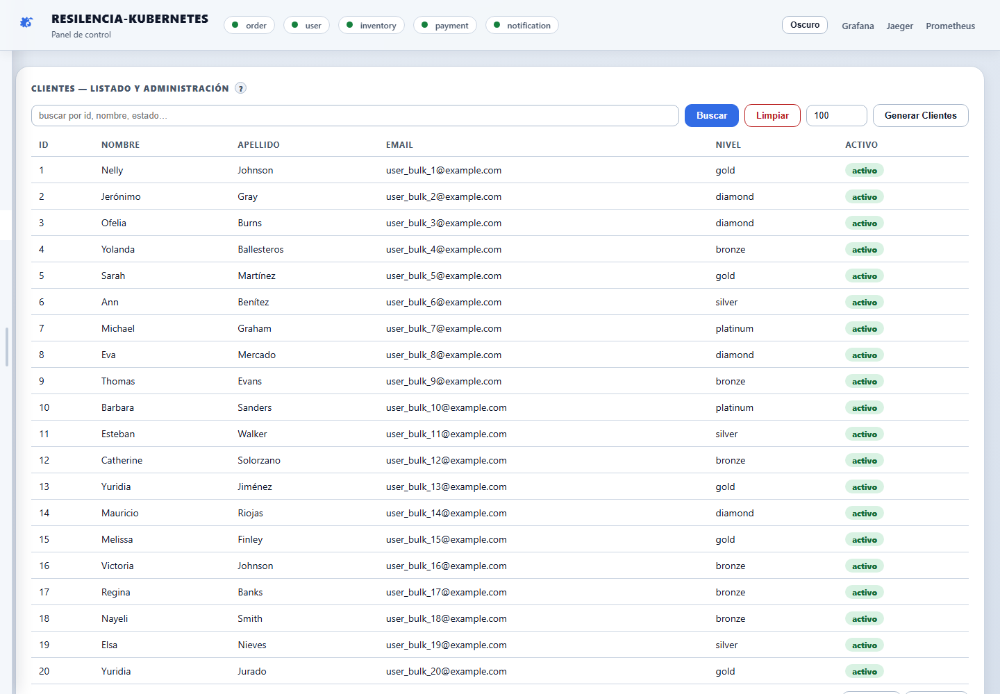

Para colocar una orden, usa un cliente marcado como **activo**. El ID `1` suele
ser suficiente en una instalación nueva, pero compruébalo en la tabla.

### 6.2 Productos

En una base limpia, abre **Inventario**:

1. Localiza el campo numérico junto al botón **Generar Productos**.
2. Escribe `20` para una prueba ligera, o el número deseado.
3. Pulsa **Generar Productos**.
4. Espera a que la tabla muestre filas con stock y precio.
5. Anota un ID con stock mayor que cero; por ejemplo, `1`.

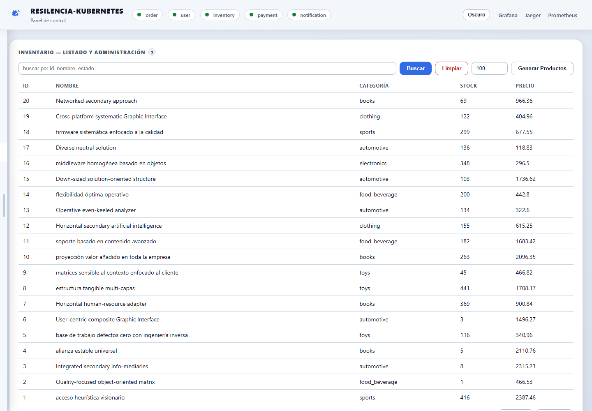

También puedes generarlos por API:

```powershell
Invoke-RestMethod -Method Post `
  -Uri "http://localhost:8102/inventory/faker?count=20"
```

Verifica el total:

```powershell
Invoke-RestMethod http://localhost:8102/inventory/count
```

## 7. Recorrido por el panel de control

Abre http://localhost:8105.

El encabezado contiene:

- indicadores verdes o rojos para los cinco microservicios;
- selector de tema claro/oscuro;
- enlaces directos a Grafana, Jaeger y Prometheus;
- nueve pestañas: Inicio, Pruebas, Observabilidad, Kubernetes, Órdenes,
  Clientes, Inventario, Pagos y Notificaciones.

### 7.1 Pestaña Inicio

La pantalla Inicio representa el flujo de servicios y permite cambiar la
estrategia de resiliencia:

- **Baseline:** sin reintentos ni circuit breaker;
- **Reintentos:** intenta nuevamente llamadas que fallen;
- **Circuit breaker:** protege el flujo frente a fallos repetidos de pagos;
- **Kubernetes:** usa la modalidad de orquestación prevista para el cluster.

La estrategia resaltada en azul es la activa. En la siguiente captura real se
encuentra seleccionado **Circuit breaker**, su estado es `CLOSED`, los cinco
servicios están `UP` y existe una orden reciente pagada.

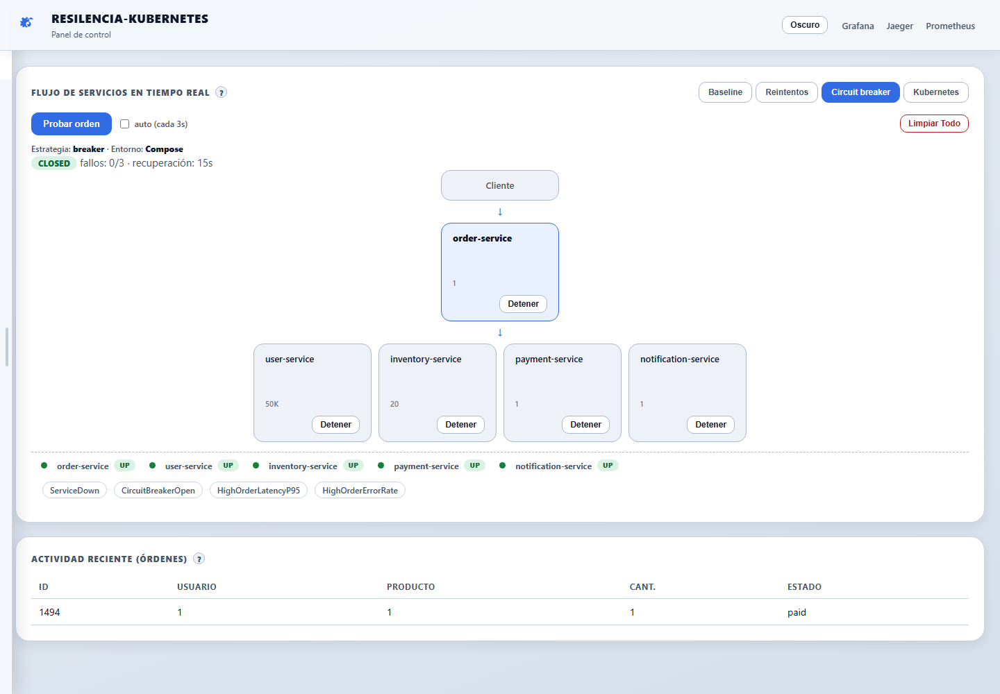

Controles principales:

- **Probar orden:** crea una orden con los valores internos de demostración.
- **auto (cada 3s):** repite la prueba automáticamente; desactívalo al terminar.
- **Detener:** detiene el contenedor del servicio seleccionado. Úsalo solo para
  pruebas y vuelve a iniciarlo desde el mismo panel.
- **Limpiar Todo:** operación destructiva; elimina datos administrados por el
  panel. No la uses si quieres conservar los resultados.

## 8. Colocar y consultar órdenes

Abre **Órdenes**.

### 8.1 Colocar una orden desde el panel

1. En `user_id`, escribe el ID de un cliente activo.
2. En `product_id`, escribe el ID de un producto con stock.
3. En `cantidad`, escribe una cantidad menor o igual al stock disponible.
4. Pulsa **Colocar**.
5. Espera la respuesta. El flujo llama de forma síncrona a los otros cuatro
   servicios, por lo que puede tardar más si hay chaos o reintentos activos.
6. Confirma el mensaje verde `status: success — Order completed successfully`.
7. Confirma que la tabla inferior muestre la orden como `paid` y `completed`.

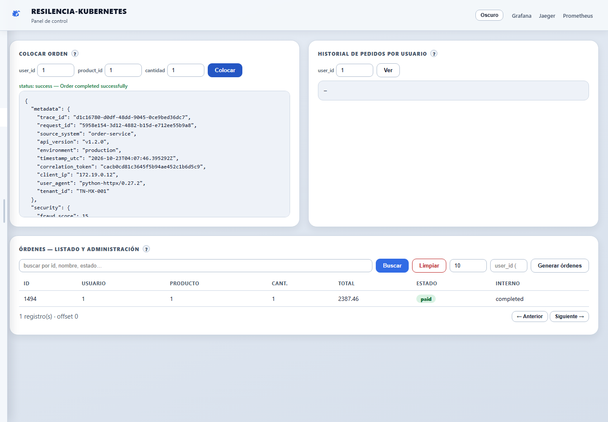

La captura muestra una ejecución real con:

- `user_id=1`;
- `product_id=1`;
- `cantidad=1`;
- respuesta `success`;
- orden persistida en estado `paid`;
- estado interno `completed`.

El bloque JSON contiene metadatos, seguridad simulada, IDs de correlación,
resultados downstream, tiempos y número de intentos. No es necesario editarlo;
es evidencia del recorrido completo.

### 8.2 Consultar el historial de un cliente

1. Escribe el ID en **Historial de pedidos por usuario**.
2. Pulsa **Ver**.
3. El panel mostrará las órdenes asociadas a ese cliente.

### 8.3 Buscar y administrar órdenes

La tabla inferior permite:

- buscar por ID, usuario o estado;
- cambiar el número de registros por página;
- generar órdenes en lote;
- abrir una fila para ver detalles;
- modificar estado y prioridad;
- borrar una orden.

Las operaciones de edición y borrado modifican PostgreSQL inmediatamente.

### 8.4 Colocar una orden desde PowerShell

```powershell
$body = @{
  user_id = 1
  product_id = 1
  quantity = 1
} | ConvertTo-Json

Invoke-RestMethod -Method Post `
  -Uri http://localhost:8100/orders `
  -ContentType "application/json" `
  -Body $body
```

## 9. Clientes, inventario, pagos y notificaciones

### 9.1 Clientes

La pestaña **Clientes** permite buscar, paginar, generar y consultar usuarios.
Pulsa una fila para abrir sus detalles y las acciones disponibles.


Una orden falla en la etapa de validación si el cliente no existe o está
inactivo.

### 9.2 Inventario

La pestaña **Inventario** muestra ID, nombre, categoría, stock y precio.


Antes de una prueba:

1. verifica que el producto exista;
2. comprueba que el stock sea suficiente;
3. recuerda que una orden exitosa descuenta inventario;
4. si el flujo falla después de la reserva, revisa si la compensación devolvió
   el stock.

### 9.3 Pagos

La pestaña **Pagos** lista los pagos persistidos. Una orden exitosa debe producir
un pago `completed` asociado al mismo ID de orden.

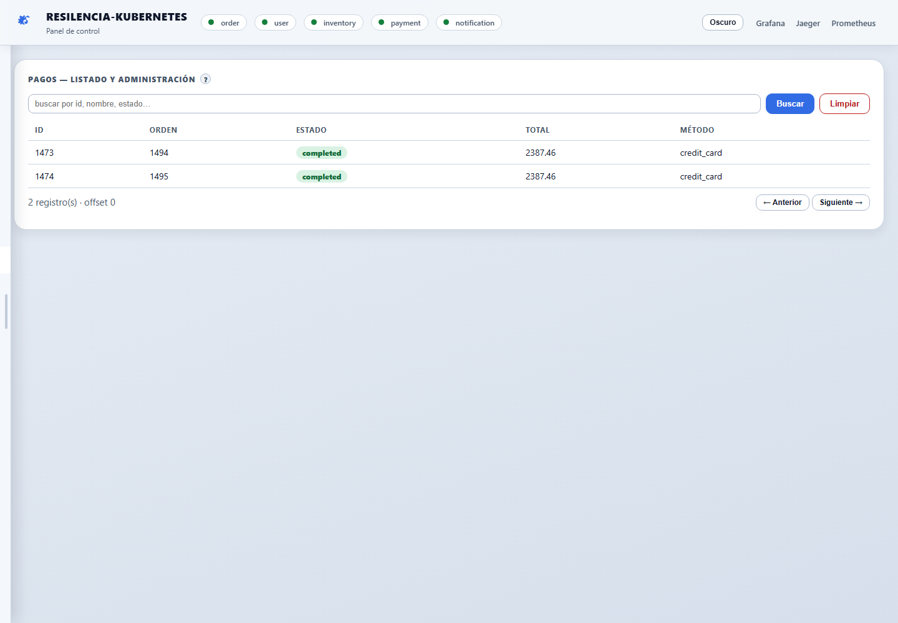

El pago es simulado: no contacta a una pasarela bancaria real ni utiliza una
tarjeta verdadera.

### 9.4 Notificaciones

La pestaña **Notificaciones** muestra el ID, orden, usuario, estado y canal.

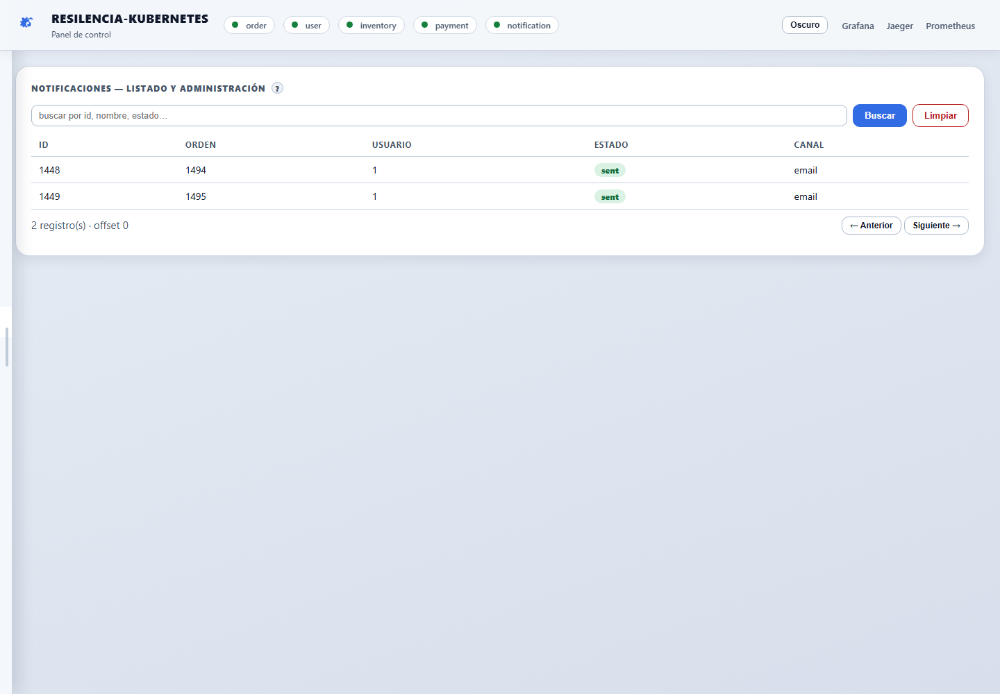

Una orden exitosa normalmente registra una notificación `sent` por `email`.
No se envía un correo real; el resultado se simula y se persiste.

## 10. Pruebas de tráfico y chaos engineering

Abre **Pruebas**. Antes de comenzar, confirma que los cinco indicadores del
encabezado estén verdes.

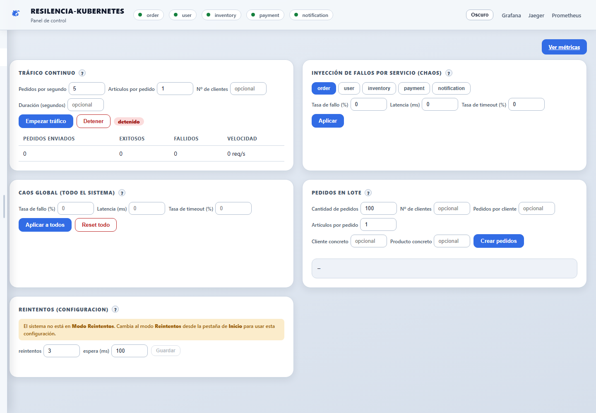

### 10.1 Tráfico continuo

1. Define **Pedidos por segundo**. Empieza con `1` o `2`.
2. Usa `1` en **Artículos por pedido**.
3. Opcionalmente limita el número de clientes.
4. Define una duración, por ejemplo `30` segundos. Si queda vacía, el tráfico
   continúa hasta que pulses **Detener**.
5. Pulsa **Empezar tráfico**.
6. Observa pedidos enviados, exitosos, fallidos y velocidad.
7. Pulsa **Detener** antes de cambiar de escenario.

> [!CAUTION]
> Una tasa alta puede consumir rápidamente el inventario y generar grandes
> cantidades de órdenes, pagos, notificaciones, métricas y trazas.

### 10.2 Chaos por servicio

1. Elige `order`, `user`, `inventory`, `payment` o `notification`.
2. Configura uno o más parámetros:
   - **Tasa de fallo (%):** probabilidad de error por solicitud.
   - **Latencia (ms):** retraso añadido a cada solicitud.
   - **Tasa de timeout (%):** probabilidad de esperar 30 segundos.
3. Pulsa **Aplicar**.
4. Ejecuta órdenes y observa el comportamiento.
5. Restablece los valores a `0` al terminar.

Ejemplo seguro para observar latencia:

```text
Servicio: payment
Tasa de fallo: 0
Latencia: 500 ms
Tasa de timeout: 0
```

### 10.3 Chaos global

**Aplicar a todos** envía la misma configuración a los cinco servicios. Este
escenario es más agresivo. Utiliza valores bajos y una duración corta.

Al terminar, pulsa **Reset todo** y confirma que fallo, latencia y timeout vuelvan
a cero.

### 10.4 Pedidos en lote

1. Empieza con `10` pedidos, no con una cantidad grande.
2. Usa cantidad `1` por pedido.
3. Opcionalmente fija un cliente y un producto conocidos.
4. Pulsa **Crear pedidos**.
5. Revisa los contadores `creados` y `fallidos`.

Cada pedido recorre el flujo real completo; no es una inserción directa.

### 10.5 Reintentos

La configuración se habilita únicamente cuando:

- el entorno de ejecución es Compose; y
- la estrategia **Reintentos** está activa en Inicio.

Procedimiento:

1. vuelve a **Inicio**;
2. selecciona **Reintentos**;
3. regresa a **Pruebas**;
4. configura el número de reintentos y la espera en milisegundos;
5. pulsa **Guardar**;
6. aplica un porcentaje bajo de fallo a un servicio;
7. coloca varias órdenes y revisa `attempts` en la respuesta.

## 11. Observabilidad con Prometheus, Grafana y Jaeger

Genera al menos una orden antes de abrir las herramientas. Sin tráfico, varios
paneles mostrarán cero o no tendrán series recientes.

### 11.1 Observabilidad integrada en el panel

La pestaña **Observabilidad** resume:

- latencia p50, p95 y p99;
- solicitudes por segundo;
- errores por segundo y porcentaje de error;
- CPU, memoria y escritura de disco por servicio;
- estado de los targets de Prometheus;
- alertas configuradas.

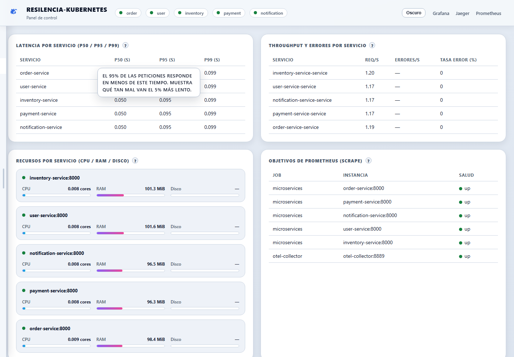

Interpretación rápida:

- **p50:** la mitad de las solicitudes responde en ese tiempo o menos.
- **p95:** el 95 % responde en ese tiempo o menos.
- **p99:** permite detectar la cola lenta.
- **req/s:** volumen de solicitudes por segundo.
- **tasa de error:** proporción de respuestas fallidas.
- **target `up`:** Prometheus puede recolectar métricas del componente.

### 11.2 Grafana

Abre http://localhost:3001 o pulsa **Grafana** en el encabezado.

El dashboard provisionado **Resilencia Overview** agrupa desempeño, resiliencia,
recursos y observabilidad. En la captura real se observan datos de latencia,
throughput, estado del circuit breaker, CPU y memoria.

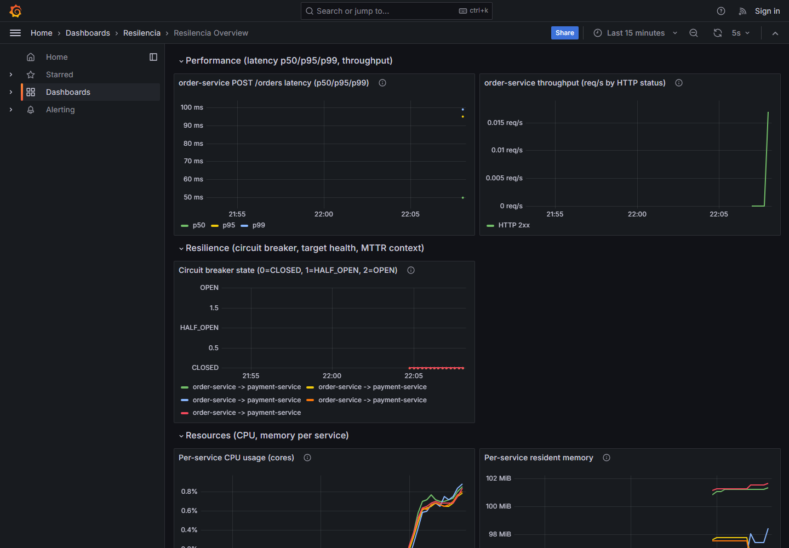

Si un panel muestra `No data`:

1. coloca varias órdenes;
2. espera dos ciclos de scrape;
3. cambia el rango a **Last 15 minutes**;
4. pulsa actualizar;
5. confirma en Prometheus que los targets estén `UP`.

### 11.3 Jaeger

Abre http://localhost:16687 o pulsa **Jaeger**.

1. En **Service**, selecciona `order-service`.
2. Usa **Last Hour** en Lookback.
3. Pulsa **Find Traces**.
4. Abre una traza `POST /orders` para revisar la jerarquía y duración de spans.

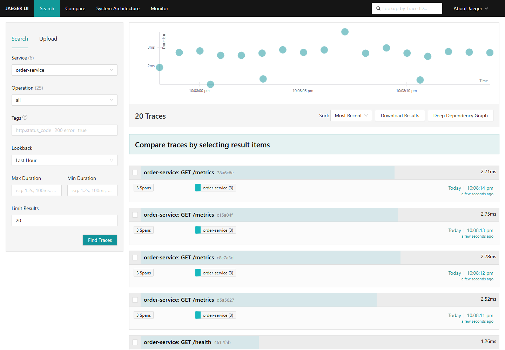

La captura muestra trazas reales recientes. Prometheus también consulta
`GET /metrics`, por lo que esas operaciones aparecen junto a las órdenes.

### 11.4 Prometheus

Abre http://localhost:9091.

Consultas útiles:

```promql
up
```

```promql
rate(http_requests_total[1m])
```

```promql
histogram_quantile(0.95, sum by (le, service) (rate(http_request_duration_seconds_bucket[5m])))
```

Los nombres concretos de etiquetas pueden variar según la métrica. Usa el
autocompletado de Prometheus para confirmar las series presentes.

## 12. Uso de Swagger y de la API

Cada microservicio publica documentación OpenAPI en `/docs`.

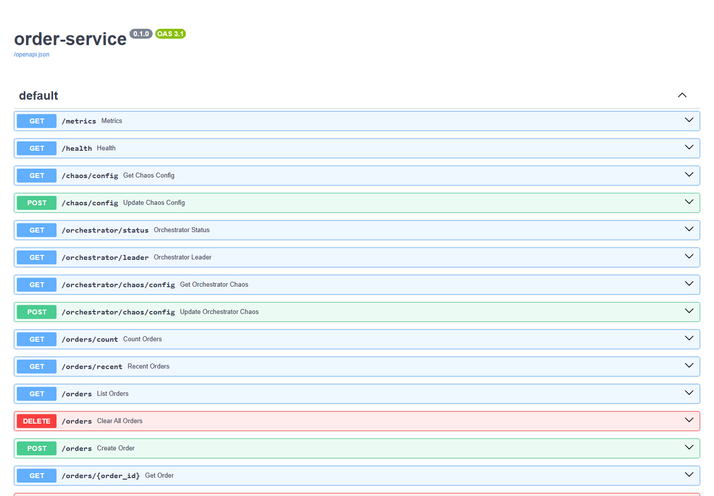

En `order-service` aparecen, entre otros:

- `GET /health`;
- `GET /metrics`;
- `GET` y `POST /chaos/config`;
- `GET /orchestrator/status`;
- `GET /orchestrator/leader`;
- `GET /orders`;
- `POST /orders`;
- `GET /orders/{order_id}`;
- endpoints de conteo, órdenes recientes y resiliencia.

Para ejecutar una operación desde Swagger:

1. abre el endpoint;
2. pulsa **Try it out**;
3. completa parámetros o cuerpo JSON;
4. pulsa **Execute**;
5. revisa Request URL, Response code y Response body.

> [!CAUTION]
> Los endpoints `DELETE` modifican o eliminan datos. No los ejecutes solo para
> probar la interfaz.

## 13. Uso del CLI

El CLI consume las mismas APIs HTTP del panel.

Ayuda general:

```powershell
python cli.py --help
```

Estado de todos los servicios:

```powershell
python cli.py status
```

Colocar una orden:

```powershell
python cli.py order place --user-id 1 --product-id 1 --quantity 1
```

Listar órdenes recientes:

```powershell
python cli.py order recent
```

Consultar inventario:

```powershell
python cli.py inventory list
```

Consultar el circuit breaker:

```powershell
python cli.py circuit-breaker status
```

Ver opciones de chaos:

```powershell
python cli.py chaos --help
python cli.py chaos set --help
python cli.py chaos reset --help
```

Los comandos destructivos o de estado compartido pueden pedir confirmación.
Utiliza `--yes` únicamente cuando entiendas el cambio que se aplicará.

## 14. Ejecución opcional en Kubernetes

### 14.1 Inicio automatizado

```bash
./run.sh k8s
```

### 14.2 Inicio manual de referencia

```powershell
minikube start --driver=docker
minikube addons enable metrics-server
```

Construye y carga las imágenes:

```powershell
$services = @(
  "user-service",
  "inventory-service",
  "payment-service",
  "notification-service",
  "order-service"
)

foreach ($svc in $services) {
  docker build -t "${svc}:latest" ".\services\$svc"
  minikube image load "${svc}:latest"
}
```

Aplica los manifiestos:

```powershell
kubectl apply -f k8s/base/
kubectl apply -f k8s/resilience/hpa.yaml
kubectl get pods
kubectl get hpa
```

### 14.3 Integración del panel con Kubernetes

La pestaña Kubernetes de Compose es opcional. Si `K8S_API_SERVER` está vacío, el
panel muestra el aviso **Kubernetes not configured**. Esto es esperado y no
indica una falla de Docker Compose.

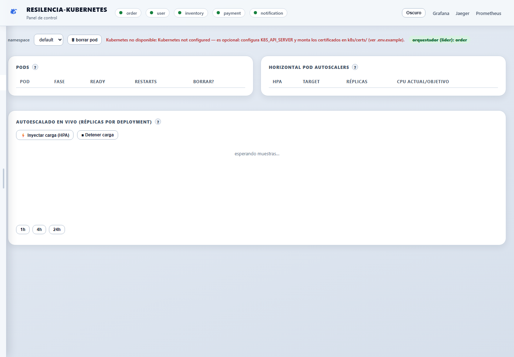

Para activarla:

1. copia `ca.crt`, `client.crt` y `client.key` a `k8s/certs/`;
2. obtén la URL del API server de minikube;
3. define `K8S_API_SERVER` y las rutas de certificados en `.env`;
4. reinicia `control-panel`;
5. vuelve a abrir la pestaña.

Consulta las instrucciones y advertencias completas de red en `.env.example` y
[`docs/TOOLING.md`](docs/TOOLING.md).

Una vez configurada, la pestaña permite:

- seleccionar namespace;
- consultar pods y reinicios;
- borrar un pod para observar self-healing;
- consultar HPAs;
- inyectar carga y observar réplicas;
- identificar al orquestador líder.

## 15. Detener, reiniciar y borrar datos

### Detener sin borrar PostgreSQL

```powershell
./run.ps1 down
```

`run.ps1` no ofrece un comando `stop`; en Windows, `down` detiene el stack y
elimina sus contenedores sin borrar los volúmenes. Si solo quieres pausar los
contenedores y conservarlos, usa directamente:

```powershell
docker compose stop
```

### Volver a iniciar

```powershell
docker compose up -d
```

### Reconstruir después de cambiar código

```powershell
docker compose up --build -d --remove-orphans
```

### Borrar contenedores y red, conservando volúmenes

```powershell
docker compose down --remove-orphans
```

### Borrar también todos los datos

```powershell
docker compose down -v --remove-orphans
```

> [!CAUTION]
> `docker compose down -v` elimina el volumen de PostgreSQL y los datos de
> Grafana. Después tendrás que ejecutar nuevamente el seeder y generar productos.

## 16. Escenarios reproducibles

### Escenario A: verificar el flujo normal

1. inicia el stack;
2. genera 20 productos;
3. selecciona **Baseline** en Inicio;
4. coloca una orden con cliente activo y producto con stock;
5. confirma `success`, `paid` y `completed`;
6. revisa el pago y la notificación;
7. abre Grafana y Jaeger.

Resultado esperado: la orden completa los cuatro pasos downstream sin
reintentos ni compensación.

### Escenario B: medir latencia artificial

1. abre Pruebas;
2. selecciona `payment`;
3. aplica `0 %` fallo, `500 ms` latencia y `0 %` timeout;
4. coloca de tres a cinco órdenes;
5. revisa el tiempo de pago en la respuesta;
6. revisa p95/p99 en Observabilidad y Grafana;
7. devuelve la latencia a `0`.

Resultado esperado: las órdenes siguen funcionando, pero la latencia del flujo
aumenta aproximadamente por el retraso agregado.

### Escenario C: observar reintentos

1. selecciona **Reintentos** en Inicio;
2. configura tres intentos y 100 ms de espera;
3. aplica un fallo moderado, por ejemplo `30 %`, a `payment`;
4. coloca varias órdenes;
5. revisa `attempts.payment` en el JSON;
6. compara éxitos y fallos;
7. pulsa **Reset todo**.

Resultado esperado: algunas llamadas requieren más de un intento y una fracción
de las órdenes puede recuperarse.

### Escenario D: observar el circuit breaker

1. selecciona **Circuit breaker** en Inicio;
2. aplica `100 %` de fallo a `payment`;
3. coloca órdenes repetidamente hasta alcanzar el umbral;
4. observa el cambio de `CLOSED` a `OPEN`;
5. mientras está abierto, confirma que el sistema evita nuevas llamadas de pago;
6. restablece el chaos de pagos;
7. espera el tiempo de recuperación indicado en Inicio;
8. realiza una solicitud de prueba para observar `HALF_OPEN` y el regreso a
   `CLOSED` si la llamada funciona.

Resultado esperado: el circuit breaker limita la presión sobre el servicio de
pagos durante el fallo repetido.

### Escenario E: comprobar una traza distribuida

1. coloca una orden exitosa;
2. abre Jaeger;
3. selecciona `order-service` y Last Hour;
4. busca una operación `POST /orders`;
5. abre la traza;
6. identifica spans de usuario, inventario, pago y notificación;
7. compara las duraciones con el bloque `timings` de la respuesta.

## 17. Solución de problemas

### Docker no responde

Síntoma:

```text
failed to connect to the docker API
```

Solución:

1. inicia Docker Desktop;
2. espera a que indique que el motor está listo;
3. ejecuta `docker version`;
4. repite `docker compose up -d`.

### BuildKit informa `parent snapshot ... does not exist`

```powershell
docker compose build --no-cache
docker compose up -d
```

### El panel abre, pero un servicio aparece rojo

```powershell
docker compose ps
docker compose logs --tail=100 order-service
docker compose logs --tail=100 payment-service
```

Sustituye el nombre por el servicio marcado como caído.

### Los indicadores del encabezado no aparecen en la primera carga

En la versión auditada, el navegador puede registrar el error de inicialización
`Cannot access 'healthStripInFlight' before initialization` durante la primera
carga de Inicio. Las tarjetas y APIs pueden seguir funcionando. Recarga la
página o cambia de pestaña y vuelve a Inicio; después verifica la salud real con
`python cli.py status`. Este comportamiento es una limitación conocida del panel,
no una caída automática de los microservicios.

### No hay productos y las órdenes fallan

Causa habitual: `SEED_PRODUCTS_COUNT=0`.

Solución:

- abre Inventario y pulsa **Generar Productos**; o
- ejecuta `POST /inventory/faker?count=20`; o
- cambia `SEED_PRODUCTS_COUNT` antes de recrear una base limpia.

### La orden devuelve usuario no válido

- comprueba que el ID exista en Clientes;
- abre la fila y confirma que esté activo;
- prueba con otro cliente activo.

### La orden devuelve inventario insuficiente

- revisa el stock del producto;
- reduce la cantidad;
- genera productos adicionales;
- usa un ID con stock mayor que cero.

### La orden tarda 30 segundos o más

Probablemente `TIMEOUT_RATE` está activo. Abre Pruebas y pulsa **Reset todo**.

### El seeder parece detenido

```powershell
docker compose logs -f data-seeder
```

Comprueba el total directamente:

```powershell
docker compose exec postgres psql `
  -U resilencia -d resilencia_db `
  -c "SELECT COUNT(*) FROM users;"
```

### Grafana muestra `No data`

- genera tráfico;
- espera el siguiente scrape;
- selecciona un rango reciente;
- revisa http://localhost:9091/targets;
- confirma que los targets estén `UP`.

### Jaeger no muestra servicios

- coloca al menos una orden;
- espera unos segundos;
- recarga Jaeger;
- confirma que `otel-collector` esté activo.

### Kubernetes muestra `not configured`

Es normal en Compose. Configura `K8S_API_SERVER` y certificados únicamente si
deseas conectar el panel a un cluster.

### Un puerto está ocupado

Cambia la variable correspondiente en `.env` y recrea el stack. Ejemplo:

```env
ORDER_SERVICE_PORT=8200
GRAFANA_PORT=3101
```

Después usa los nuevos puertos en el navegador.

## 18. Limitaciones conocidas

- El sistema no implementa autenticación real en las operaciones administrativas.
- El panel puede acceder al socket de Docker para iniciar o detener servicios.
- El estado de chaos, reintentos y circuit breaker es local al proceso; con varias
  réplicas puede no ser idéntico entre pods.
- Los reintentos no incluyen una estrategia completa de idempotencia distribuida.
- Existe una ruta de error conocida en la que una reserva de inventario puede no
  compensarse correctamente.
- La elección de líder depende de PostgreSQL y puede degradarse de forma insegura
  si la base deja de estar disponible.
- El failover de PostgreSQL es manual y no incorpora fencing automático.
- La configuración Helm es experimental y no ofrece equivalencia funcional total
  con los manifiestos de `k8s/`.
- Los endpoints `DELETE` y controles de parada no solicitan autenticación.
- Los datos, pagos, direcciones, autenticación y notificaciones son simulados.

## 19. Mapa de archivos y documentación

```text
Resilencia-Kubernetes/
├── GUIA_DE_USO.md                 # Esta guía
├── USAGE_GUIDE.md                 # Guía breve en inglés
├── README.md                      # Referencia principal del proyecto
├── compose.yml                    # Stack local
├── .env.example                   # Variables configurables
├── cli.py                         # Cliente por terminal
├── db/init.sql                    # Esquema PostgreSQL
├── services/
│   ├── control-panel/             # Panel web
│   ├── data-seeder/               # Seed automático
│   ├── shared/orchestrator.py     # Orquestación y resiliencia compartida
│   └── *-service/                 # Cinco microservicios
├── observability/                 # Prometheus, Grafana y OTel
├── k8s/                           # Manifiestos Kubernetes
├── charts/resilencia/             # Chart Helm experimental
├── scripts/                       # Arranque, carga y utilidades
└── docs/
    ├── 01.Arquitectura.md
    ├── TOOLING.md
    ├── RESULTS.md
    ├── services/
    ├── tests/
    └── guide/images/              # Capturas reales usadas aquí
```

Documentos recomendados para profundizar:

- [`README.md`](README.md): visión general y comandos principales.
- [`docs/01.Arquitectura.md`](docs/01.Arquitectura.md): arquitectura interna.
- [`docs/TOOLING.md`](docs/TOOLING.md): herramientas, resiliencia y operaciones.
- [`docs/services/`](docs/services/): detalle de cada microservicio.
- [`docs/RESULTS.md`](docs/RESULTS.md): resultados consolidados.
- [`docs/tests/`](docs/tests/): evidencia y resultados por escenario.
